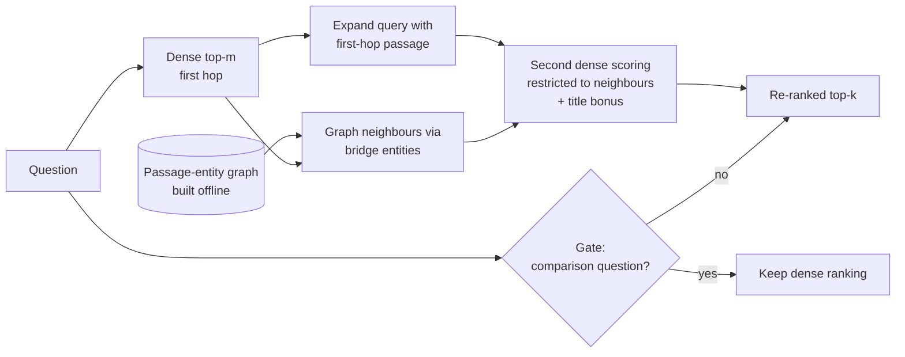

<div align="center">

# Two-Hop Graph Re-Ranking for Multi-Hop RAG

**A lightweight passage–entity graph that helps a dense retriever find the second supporting passage. No LLM calls at indexing time.**

[](https://doi.org/10.5281/zenodo.23445104)
[](LICENSE)


%20submission-orange)

*Code, per-question results and paper source for* **"Graph-Augmented Retrieval for Multi-Hop Question Answering: Lightweight Entity-Graph Two-Hop Re-Ranking"**

</div>

---

## TL;DR

- Dense retrievers score each passage alone, so they often miss the **second** passage of a multi-hop question.
- We build a **passage–entity graph offline** (rule-based + spaCy NER, no LLM) and, after the first hop, boost only the passages **linked through a bridge entity** using a query expanded with the first-hop passage.
- A small **question-type gate** (selected on training data) skips comparison questions.
- **Result:** on pooled HotpotQA corpora, All@5 rises from ~70% to ~80–82%. Controls show that the **Wikipedia-title link** explains most of the gain, and two new stress tests (below) show where it stops working.

## How it works



| Variant | What it is |
|---|---|
| **Two-hop + gate** | graph-restricted boost from the expanded query, plus a title bonus; gate skips comparison questions |
| **TitleLink** | graph + title match only, no expanded query (a control that turned out to be strong) |
| Baselines | dense (BGE), BM25+dense fusion, question-title boost, SPRIG-like and LinearRAG-like re-implementations, cross-encoder |

## Main results

Retrieval quality, **All@5** (all supporting passages in the top 5), %, BGE-small, 1,000 questions per set. Settings were tuned on HotpotQA **train** only and frozen; 2WikiMultiHopQA and MuSiQue are zero-shot transfer.

| System | HotpotQA A | HotpotQA B | 2Wiki | MuSiQue |
|---|---:|---:|---:|---:|
| Dense (BGE-small) | 70.2 | 69.8 | 38.2 | 15.3 |
| BM25 + dense fusion (RRF, untuned) | 70.8 | 68.5 | 37.6 | 14.8 |
| Question-title boost (no first hop) | 70.5 | 69.9 | 38.4 | 14.8 |
| SPRIG-like *(re-implementation)* | 70.3 | 69.9 | 38.3 | 15.3 |
| LinearRAG-like *(re-implementation)* | 62.0 | 62.0 | 44.0 | 13.0 |
| **Two-hop + gate** | 79.6 | **81.6** | 60.5 | **21.8** |
| **TitleLink** | **82.3** | **81.6** | **75.2** | 16.5 |

The gain also holds with BGE-base and BGE-large and on an untouched HotpotQA sample (paper, Section 7.8).

## Stress tests: where the method stops working

We report these because they are negative or limiting. Sample C (1,000 untouched HotpotQA dev questions), BGE-small, All@5 %:

| Pool | Titles | Dense | TitleLink | Two-hop | Two-hop + gate |
|---|---|---:|---:|---:|---:|
| 66,635 passages | real | 59.6 | 71.3 | 67.4 | **71.7** |
| 66,635 passages | **blind** | 57.4 | 57.4 | 56.8 | 56.8 |
| 500,002 passages | real | 47.4 | 46.5 | 50.3 | **57.4** |
| 500,002 passages | **blind** | 45.2 | 45.2 | 37.5 | 37.5 |

- **Scale (500,002 passages = all dev paragraphs + paragraphs of 87,708 train questions).** Only the **gated** method keeps a significant gain over dense (+10.0 All@5, 95% CI +7.2 to +12.8). TitleLink alone (-0.9) and ungated two-hop (+2.9) lose it.
- **Blind titles (every title replaced by `doc_<i>`).** The gain disappears, and at 500k the re-ranker is *worse* than dense. **Use the method only on corpora whose passages carry an informative entity title.**
- Cost at 500k on one H200: graph build ~34 s, encoding ~200 s, ~4.7 GB RAM, 295 ms/question for the gated method (dense: 12 ms).

Per-question files: [`results_h200/scale500k/`](results_h200/scale500k).

## Repository layout

```
code/kgrag/           graph, retrievers (BM25, dense, PPR hybrid, two-hop, TitleLink, baselines),
                      generation, metrics, runner, scale500k, table and figure generation
code/tests/           unit tests
code/run_h200_*.sh    reproduction scripts (resumable)
results/              tuned hyper-parameters, summaries and per-question files of every reported run
results/controls/     controls, candidate coverage, audit and corpus-scale runs
results/sample_ids/   exact question ids of samples A and B (159 in common)
results_h200/scale500k/  500k-pool and blind-title runs
paper/                LaTeX source, generated tables and figures
```

## Quick start

```bash
python -m venv .venv && source .venv/bin/activate
pip install -r code/requirements.txt
python -m spacy download en_core_web_sm
cd code && python -m unittest discover -s tests
```

<details>
<summary><b>Reproduce every experiment</b> (one machine, NVIDIA H200 NVL)</summary>

```bash
bash run_h200_all.sh            # tuning on train, all systems on the four sets, answers, controls, coverage, scale, latency
bash run_h200_fix.sh            # full tuning grid (records the train tie) + main HotpotQA run with all baselines
bash run_h200_abl.sh            # retrieval-only ablations of the earlier PPR hybrid
bash run_h200_r6.sh             # extra baselines, BGE-base/large, untouched sample C
bash run_h200_scale500k_par.sh  # 500,002-passage pool + blind-title control (one configuration per GPU)
```

Each script writes a tarball of its results. HotpotQA, 2WikiMultiHopQA and MuSiQue are downloaded from the Hugging Face hub at run time; no external API is used.

</details>

<details>
<summary><b>Regenerate tables and figures</b></summary>

```bash
cd code; H=../results
python -m kgrag.make_tables --runs "HotpotQA=$H/hotpot" --eval "SampleA=$H/eval_v2_seed0" "SampleB=$H/eval_v2_seed1" \
  --signif "HotpotQA (sample A)=$H/hotpot" "HotpotQA (sample B)=$H/eval_v2_seed1" \
  --tuned $H/tuned.json --tuned2 $H/tuned2.json --out ../paper
python -m kgrag.extended --hotpot $H/hotpot --a $H/eval_v2_seed0 --b $H/eval_v2_seed1 --wiki $H/eval_2wiki --musique $H/eval_musique --out ../paper
python -m kgrag.analysis --a $H/eval_v2_seed0 --b $H/eval_v2_seed1 --out ../paper
python -m kgrag.report_controls --dir ../results/controls --out ../paper --timing "Gpu small=$H/timing_h200_1k.json" "Gpu full=$H/timing_h200_full.json"
python -m kgrag.report_gpu --res $H --out ../paper
python -m kgrag.report_r6 --res $H --out ../paper
python -m kgrag.report_scale --res ../results_h200/scale500k --out ../results_h200/scale500k/tables
python -m kgrag.make_figures --res $H --out ../paper/figs
python check_review3.py claims   # also: related cover build sampleids
```

Every table and number in the paper is generated from the stored per-question files.

</details>

## Setup used

| Item | Value |
|---|---|
| Hardware | one machine, NVIDIA H200 NVL (driver 595.71.05, `results/gpu.txt`) |
| Dense encoder | `BAAI/bge-small-en-v1.5` (also BGE-base and BGE-large) |
| Cross-encoder | `BAAI/bge-reranker-base` |
| Generator | `Qwen/Qwen2.5-1.5B-Instruct` |
| NER | spaCy `en_core_web_sm` + rule-based capitalised spans |
| Method settings (frozen) | m = 3, γ = 0.3, title bonus 0.5, τ = 0.1 |

## Protocol and honesty notes

- Hyper-parameters were chosen on HotpotQA **train** only (`results/tuned*.json`). On train, (m=2, γ=0.2) and (m=3, γ=0.3) **tie at 85.8%**; the setting frozen before evaluation (m=3, γ=0.3) was kept and the tie is recorded in `tuned2.json`.
- Samples A (seed 0) and B (seed 1) are 1,000 HotpotQA questions each; B was reused after the gate and cross-encoder were added (see the paper's evaluation protocol). Sample C (seed 2) was evaluated once after freezing all methods.
- The SPRIG-like and LinearRAG-like systems are **simplified, untuned re-implementations**, not the authors' code.
- We do **not** claim reduced hallucination; unsupported answers fall only slightly.
- Pools are built from HotpotQA/2Wiki/MuSiQue paragraphs, not a Wikipedia-scale index. Latency comes from one device and stack and is indicative.

## Citation

Please cite the archived release (the latest version is listed on the [Zenodo record](https://doi.org/10.5281/zenodo.23445104)) and the paper once published:

```bibtex
@misc{zeyad2026twohop,
  title        = {Graph-Augmented Retrieval for Multi-Hop Question Answering:
                  Lightweight Entity-Graph Two-Hop Re-Ranking},
  author       = {Zeyad, Akram Taha and Jasim, Fanan Hikmat},
  year         = {2026},
  howpublished = {\url{https://github.com/Akramtaha98/twohop-graph-rerank-rag}},
  doi          = {10.5281/zenodo.23445104}
}
```

## License

MIT. See [LICENSE](LICENSE).
